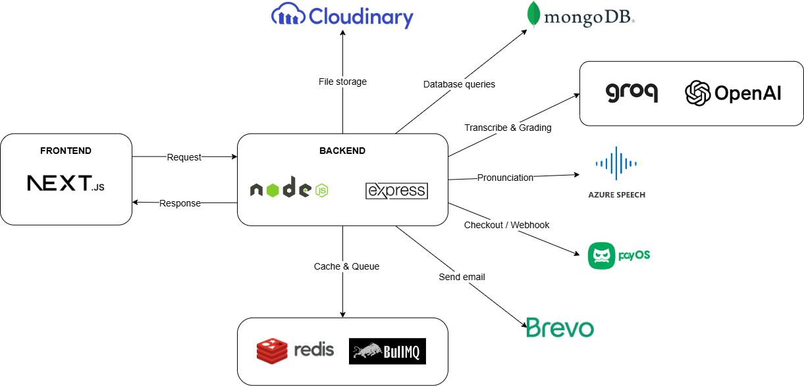
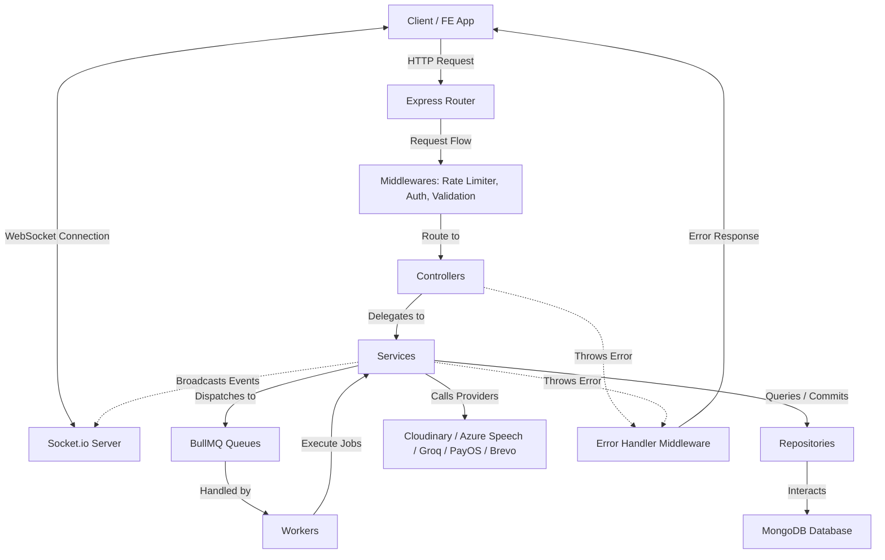

# Speprove Backend

## Introduction
Speprove Backend is a modular monolith backend service for the Speprove IELTS Speaking platform. Built with Node.js, Express (v5), and TypeScript, it provides REST APIs, AI-powered speaking evaluation, background processing, real-time communication, and secure payment integration.

---

## Features

### User & Authentication
- Secure authentication utilizing JWT refresh token rotation.
- Google OAuth2 single-sign-on integration.
- Secure email registration verification via Brevo OTP.
- Profile management: APIs for avatar uploads (via Cloudinary), profile editing, password updates, and user preferences.
- Role-based access control (RBAC) with granular permissions.

### Speaking Content
- Curated IELTS speaking forecasts, topics, and question banks.
- Well-structured question sets covering Parts 1, 2, and 3 of the IELTS Speaking test.
- Curated and AI-generated vocabulary suggestions for each question.
- Configurable TTS audio generation for questions and mock test instructions using multiple examiner voices.

### Speaking Practice
- Self-paced practice on selected topics and questions.
- Audio submission processing, file uploads, and question-level attempt tracking.
- Practice history tracking mapped directly to each practiced question.
- Public sharing and leaderboards: publish attempts and reference high-scoring recordings from other users.

### Mock Tests
- Customizable mock exams: support for individual parts (Part 1, 2, or 3) or full-length IELTS Speaking simulation tests.
- Sequential question delivery simulating a real IELTS Speaking interview.
- Realistic IELTS Speaking simulation with randomized topics and strict timing.
- Session state recovery supporting test resuming.
- Speaking test session history and results tracking.

### AI Assessment
- Unified AI-powered evaluation pipeline for practice attempts and mock test sessions.
- Automated speech transcription, pronunciation assessment, LLM-based evaluation, and IELTS band scoring.
- Stage-based retries with real-time progress updates.
- Automatic credit refunds for failed processing.

### Payments & Credit System
- Credit-based access to AI speaking practice and mock tests.
- Flexible credit packages with secure PayOS checkout.
- Transaction history and audit-ready credit logs.

---

## Tech Stack
| Category | Technology |
| :--- | :--- |
| **Runtime & Framework** | Node.js (v20+), Express (v5.x) |
| **Language** | TypeScript (v5.x) |
| **Database** | MongoDB with Mongoose (v9.x) |
| **Cache & Queue** | Redis (`ioredis`), BullMQ, `@bull-board` |
| **Dependency Injection** | `tsyringe` |
| **Validation & Schema** | Zod (v4.x) |
| **Logging** | Winston |
| **Realtime** | Socket.io |
| **Integrations** | Brevo (Email), PayOS (Payment), Cloudinary (Storage), Groq (LLM), Microsoft Speech SDK / Edge TTS (TTS) |
| **Package Manager** | `pnpm` (v10+) |

---

## Architecture

### System Integration Overview


### Internal Software Flow


---

## Getting Started

### Prerequisites
- Node.js 20+
- pnpm 10+

### Installation
```bash
pnpm install
```

### Environment Setup
Copy `.env.example` to `.env` and configure:
```bash
cp .env.example .env
```
Ensure all required environment variables are filled in.

### Development
```bash
pnpm dev
```

### Production
```bash
pnpm build
pnpm start
```

### Docker
Run the backend API container using Docker Compose:
```bash
docker-compose -f docker-compose.dev.yaml up --build
```

---

## Scripts
| Command | Description |
| :--- | :--- |
| `pnpm dev` | Start development server using `nodemon`. |
| `pnpm clean` | Delete the build directory `dist`. |
| `pnpm build` | Compile TypeScript into `dist` and align path aliases. |
| `pnpm start` | Execute the compiled production bundle (`dist/index.js`). |
| `pnpm lint` | Inspect code style using ESLint. |
| `pnpm lint:fix` | Inspect and auto-fix code style using ESLint. |
| `pnpm format` | Re-format code structure using Prettier. |
| `pnpm check` | Verify syntax compatibility (ESLint + Prettier check). |
| `pnpm db:seed` | Seed database with master and mock data. |

---

## Project Structure
```bash
src/
├── bootstrap/             # Dependency container registration
├── common/                # Shared utilities, base classes, middlewares & config
├── infrastructure/        # Caching, event-bus, socket.io, background queues & workers
├── modules/               # Domain-specific modules (Modular Monolith)
│   ├── account/           # Profile management, settings & configuration
│   ├── auth/              # JWT, Google OAuth2, & OTP authentication
│   ├── attempt/           # Question practice attempts & evaluation
│   ├── speaking-session/  # Mock exam sessions (Part 1/2/3 and Full Test)
│   ├── forecast/          # Forecast question banks, topics, and questions
│   ├── payment/           # Checkout processing & credit log tracking
│   ├── vocabulary-suggestion/ # Curated & AI vocabulary suggestions
│   └── ...                # Other domain-specific business packages
├── routes/                # Main router aggregation (APIs_V1)
└── index.ts               # Application entry point
```
