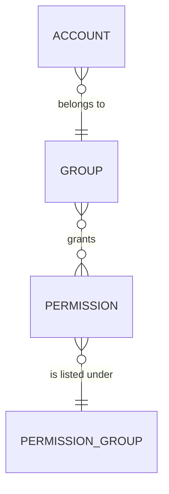

# Security and Role-Based Access

Who may do what, how that is stored, and how the code checks it. How a user proves who they are is in [authentication](./02-authentication.md).

## 1. Model

1.1. An **account** belongs to exactly one **group** (`Account.groupId`). Groups are of two kinds (`GROUP_KIND`): `ADMIN` (1) and `USER` (2).
1.2. A group holds a list of **permissions** (`Group.permissionIds`). A permission has a `name`, a `description` and a unique `pCode`.
1.3. A **permission group** only organizes permissions for display and administration (`Permission.permissionGroupId`). It grants nothing by itself.
1.4. `Account.isSuperAdmin` is exposed in the account response, but no authorization check reads it. Access is decided only by the group's permissions.

## 2. Permission Codes

2.1. Format: `RESOURCE:ACTION[:SCOPE]`, upper case, for example `ACCOUNT:VIEW`, `ACCOUNT:VIEW:ALL`, `FORECAST:CREATE`, `PERMISSION_GROUP:UPDATE`.
2.2. `RESOURCE` is the module's entity (`ACCOUNT`, `GROUP`, `PERMISSION`, `PERMISSION_GROUP`, `FORECAST`, `FORECAST_TOPIC`, ...). `ACTION` is `VIEW`, `CREATE`, `UPDATE` or `DELETE`.
2.3. `SCOPE` is optional. `ALL` means "any record, not only the user's own". A user permission with scope `ALL` satisfies a route that requires a scope; a permission without a scope does not satisfy `:ALL`.
2.4. At sign-in and at each refresh, the account's permission codes are read from its group and placed in the access token payload (`permissions: string[]`). A change to a group takes effect when the user's token is next issued.

## 3. How a Route Is Protected

| Middleware | Effect |
| :--- | :--- |
| `authMiddleware.isAuthorized` | Requires a valid access token; sets `req.user`. Missing token: `401` |
| `authMiddleware.isAuthorizedOptional` | Sets `req.user` when a valid token is present; lets a guest through |
| `authMiddleware.hasPermission('A:B[:C]' or ['...'])` | Requires **every** listed permission in `req.user.permissions`. Missing: `403` |

3.1. Order in a route: rate limit, `isAuthorized`, `hasPermission`, `validateMiddleware`, handler.
3.2. A route that changes data, or that lists the data of other users, has a `hasPermission` check. A route that is meant to be public or to belong to the signed-in user says so in a comment.
3.3. **Ownership** (a user reading only their own attempt, payment or file) is checked in the service against `req.user._id`, not by a permission. The target answer for a resource of another user is `404`, so a caller cannot learn which ids exist.

## 4. Known Gaps

These are true on the branch this document ships with. A change that fixes one removes it from this list.

4.1. Some routes lack a `hasPermission` check: `POST /credit-package`, the import of `/forecast-question`, all `/vocabulary-suggestion` routes and `PUT /voice/:id`; `GET /account/me` has its check commented out (finding F13).
4.2. Some services answer `403` for another user's resource instead of `404` (finding F6).
4.3. A denied permission answers `403` with the generic code `SYS_001` ([error codes](../08-integration-contracts/02-error-codes.md), section 4).

## 5. Web Security Controls in Place

| Control | Where |
| :--- | :--- |
| Security headers | `helmet()` in `src/app.ts`, applied before every route including the probes |
| CORS | `src/common/config/cors.config.ts`: only origins in `CORS_ORIGINS`, credentials allowed; requests with no origin (same-origin navigation, server-to-server, OAuth redirects) pass |
| Cookies | `httpOnly`; `secure` and `sameSite=none` in production, `sameSite=lax` otherwise; the refresh cookie is limited to `/api/v1/auth` |
| Passwords | Hashed with bcrypt behind `IHasher`; the password field is `select: false` |
| Input validation | Zod on every route that takes input ([validation](./04-validation.md)) |
| Rate limiting | Redis-backed; applied today to login and refresh |
| Upload checks | Size limit, MIME type and extension allow-list, and a content-type check on the file bytes (`src/modules/file/file.middleware.ts`) |
| Payment webhook | Signature verified with the PayOS checksum key; amount and state checked before credit is granted ([payment and credit](../04-business-logic/02-payment-and-credit.md)) |
| Secrets | Only in environment variables; a secret scan (gitleaks) runs in CI |
| Logs | Request id on every line; known sensitive keys are redacted |

## 6. Not Yet Covered

6.1. No CSRF defence beyond CORS and `sameSite`; the cookie policy is to be decided (finding F12).
6.2. Only login and refresh are rate limited. Registration, OTP, upload, attempt creation and payment creation are not.
6.3. A user has one session at a time ([authentication](./02-authentication.md), section 4).
6.4. The room PIN of a voice room is stored in plain text (finding F7).
