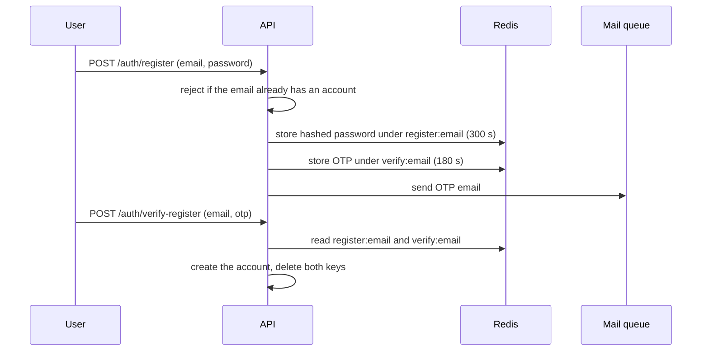

# Authentication

How a user registers, signs in, stays signed in and signs out. What a user may do after that is in [security and RBAC](./01-security-and-rbac.md). The routes are in `src/modules/auth/auth.route.ts`, the logic in `src/modules/auth/` (`auth.service.ts`, `otp.service.ts`, `google.service.ts`) and the session in `src/modules/auth/session`.

## 1. Tokens and Cookies

1.1. Two JWTs are issued at sign-in: an **access token** (signed with `ACCESS_TOKEN_SECRET_SIGNATURE`, life `ACCESS_TOKEN_LIFE`) and a **refresh token** (signed with `REFRESH_TOKEN_SECRET_SIGNATURE`, life `REFRESH_TOKEN_LIFE`). Each carries a numeric `type` (access `1`, refresh `2`) that is checked on verification, so one cannot be used as the other.
1.2. Payload: `_id`, `email`, `permissions`, `type`, `sid` (session id), and `jti` (refresh token id, refresh token only).
1.3. Web clients receive both tokens as cookies: `accessToken` (life `ACCESS_TOKEN_COOKIE_LIFE`) and `refreshToken` (limited to `/api/v1/auth`). Both are `httpOnly`; in production they are `secure` with `sameSite=none`, otherwise `lax`.
1.4. Mobile clients (`getClientType` is `mobile`) send the refresh token in the request body instead of a cookie.
1.5. The server accepts the access token from the `accessToken` cookie or from `Authorization: Bearer`.

## 2. Registration

2.1. Nothing is written to MongoDB until the OTP is verified; the pending registration lives only in Redis.
2.2. An OTP expires after 180 seconds and the pending registration after 300 seconds (`CACHE_CONFIG` in `auth.constants.ts`).
2.3. The new account is `ACTIVE`, belongs to the `USER` group, gets the default voice, a `username` taken from the part of the email before `@`, and a free credit balance of `FREE_SIGNUP_BALANCE` (50) with a matching credit log entry.

## 3. Sign-In

3.1. `POST /auth/login` is rate limited to 3 attempts per 10 seconds per user or IP (strict mode).
3.2. A wrong email and a wrong password give the same answer, `401` with `ACC_003` (`INVALID_CREDENTIALS`), so the response does not reveal which accounts exist.
3.3. A locked or deleted account answers `403` with `ACC_002`.
3.4. `GET /auth/google` starts Google sign-in with a state value stored in Redis (300 s); `GET /auth/google/callback` checks the state, requires a verified Google email and links or creates the account. An email that already belongs to a password account answers `409` (`AUTH_010`).

## 4. Session and Refresh

4.1. A **session** document (`Session` model) stores, per user, the session id (`sid`), a hash of the refresh token, the refresh token id, `expiresAt`, `lastUsedAt`, `revokedAt` and the device and IP. A TTL index removes expired sessions.
4.2. `userId` is unique, so **a user has one session**: signing in elsewhere replaces it, and the older device gets `AUTH_006` (`SESSION_REPLACED`) at its next refresh.
4.3. `POST /auth/refresh` (rate limited to 10 per 10 seconds) verifies the refresh token, loads the account and its permissions, and **rotates** the refresh token: the new token gets a new `jti`, and the stored session is updated only if the hash of the presented token matches the stored one. When rotation fails the client must sign in again, with one of three answers: `AUTH_006` (`SESSION_REPLACED`) when the session of that `sid` is gone but the user has another active one, `AUTH_005` (`SESSION_EXPIRED`) when there is no session or it is revoked or expired, and `AUTH_013` (`TOKEN_REUSED`) when the session is valid but the presented token is not the current one; in that case the session is also revoked (`TOKEN_REUSE_DETECTED`).
4.4. The access token is short-lived. When it expires the API answers `401` with `AUTH_004` (`TOKEN_EXPIRED`) and the client refreshes once and retries.

## 5. Sign-Out

5.1. `POST /auth/logout` revokes the session of the signed-in user (by `sid` when present). Without an access token it falls back to the refresh token. It always succeeds.
5.2. The cookies are cleared.

## 6. Password Management

| Flow | Route | Notes |
| :--- | :--- | :--- |
| Forgot | `POST /auth/forgot-password`, `POST /auth/verify-forgot-password`, `POST /auth/reset-password` | OTP by email; after verifying, a reset token valid for 300 seconds is issued |
| Change | `PUT /auth/change-password` | Requires sign-in and the current password |
| Set | `PUT /auth/set-password` | Requires sign-in; takes `password` and `confirmPassword`, without the current password |

## 7. Socket Tickets

7.1. A browser cannot always send cookies to the Socket.io server. `POST /auth/socket-ticket` (signed in) returns a random single-purpose ticket stored in Redis for 30 seconds under the user id. The socket handshake exchanges it for the user identity. See [queues and realtime](./05-queues-and-realtime.md).

## 8. Known Gaps

8.1. Registration, OTP verification and forgot-password are not rate limited, and an OTP has no attempt limit, so a code can be guessed by repeated tries.
8.2. The single-session rule blocks signing in on two devices.
8.3. `AuthService` mixes credential, session and social-login logic in one class of about 500 lines; the refactor splits it.
8.4. Some errors in this module omit the error code ([error codes](../08-integration-contracts/02-error-codes.md), section 4).
