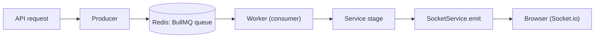

# Queues and Realtime

How work that takes seconds runs outside the HTTP request, and how the result reaches the browser. The scoring stages and their statuses are in [AI scoring](../04-business-logic/01-ai-scoring.md); this document is about the mechanism.

## 1. Overview

1.1. The API process, the workers and the Socket.io server run **in one Node process** (`src/index.ts`). Redis holds only the queues.
1.2. A request that starts long work saves its state in MongoDB, publishes a job and returns. The client learns the progress through a socket event or by reading the resource.

## 2. Queues and Jobs

| Queue | Jobs (`JOB_NAME`) | Does |
| :--- | :--- | :--- |
| `mail-queue` | `mail:send-otp` | Sends the OTP email through Brevo |
| `speaking-queue` | `speaking:transcribe`, `speaking:assess`, `speaking:evaluate`, `speaking:score-session`, `speaking:extract-vocabulary` | The scoring pipeline stages, session scoring, vocabulary extraction |

2.1. Names are constants in `src/infrastructure/queues/queue.constant.ts`. Do not write a queue or job name as a string elsewhere. `voice:generate` is defined there but no code publishes it.
2.2. A **producer** (`src/infrastructure/queues/publishers`) is the only code that adds jobs: `MailProducer`, `SpeakingProducer`.
2.3. A **consumer** (`src/infrastructure/workers/consumers`) extends `BaseConsumer`, which creates the BullMQ `Worker`, logs start, completion and failure, and runs each job inside the request id carried in the job data, so logs of one request and its jobs share an id.
2.4. Job payload types are in `src/infrastructure/queues/types`.

## 3. Job Options

3.1. Options come from three levels; the most specific wins: the job options a producer passes, then `BaseProducer.defaultOptions`, then the queue's `defaultJobOptions` in `QueueFactory`. Today every job gets the producer defaults, so the queue defaults are only a fallback.

| Setting | Value | Where |
| :--- | :--- | :--- |
| Default attempts and backoff | 3 attempts, exponential backoff starting at 2000 ms | `BaseProducer.defaultOptions` |
| Completed jobs | removed | `BaseProducer.defaultOptions` (`removeOnComplete: true`) |
| Failed jobs | kept | `BaseProducer.defaultOptions` (`removeOnFail: false`) |
| `speaking:transcribe`, `speaking:assess`, `speaking:evaluate` | 3 attempts, exponential backoff starting at 5000 ms; transcribe has priority 1 | `SpeakingProducer` |
| `speaking:score-session` | 3 attempts | `SpeakingProducer` |
| `speaking:extract-vocabulary` | 2 attempts | `SpeakingProducer` |
| `mail:send-otp` | 5 attempts, priority 1 | `MailProducer` |
| Queue fallback | 5 attempts, backoff 2000 ms, keep the last 100 completed and 500 failed | `QueueFactory` |
| Worker concurrency | 1 (one job at a time per queue) | `BaseConsumer` |

3.2. A job that throws is retried with backoff. The consumer passes `job.attemptsMade` and `job.opts.attempts` to the stage method (`jobAttempts`, `jobMaxAttempts`) so it can tell a retry from the last attempt. What happens on the last failed attempt is in the [AI scoring flow](../04-business-logic/01-ai-scoring.md).
3.3. A job must be **idempotent**: it can run twice. Work that charges, refunds or changes a score checks the stored state first: the refund of an attempt is a conditional update on `refundedAt: null`, so a second run refunds nothing.

## 4. Realtime with Socket.io

4.1. `SocketService` wraps the Socket.io server, created once from the HTTP server with the same CORS options.
4.2. **Handshake:** the client first calls `POST /auth/socket-ticket` (signed in) and passes the ticket in `socket.handshake.auth.ticket`. `socketAuthMiddleware` looks the ticket up in Redis, deletes it (single use) and stores the user id on the socket. No ticket or an unknown ticket refuses the connection.
4.3. **Rooms:** on connect the socket joins `user:<userId>`. `SocketService.emit(userId, event, data)` sends to that room, so every tab of the user receives it.
4.4. Scoring events:

| Event | Constant | Meaning |
| :--- | :--- | :--- |
| `attempt:updated` | `SOCKET_EVENTS.ATTEMPT_UPDATED` | One attempt changed stage or status |
| `mock-test:updated` | `SOCKET_EVENTS.MOCK_TEST_UPDATED` | A mock test session changed status or got its score |

4.5. Voice-room events (`VOICE_ROOM_SOCKET_EVENTS` in `voice-room.constants.ts`) cover the lobby, joining and leaving a room, chat messages, member changes and room updates. A client sends `lobby:join`, `lobby:leave`, `room:join`, `room:leave` and `chat:send`; the server broadcasts the rest to the lobby or the room.
4.6. An event carries the minimum the client needs to update the screen (ids, status, stage), not whole documents.

## 5. Monitoring

5.1. Bull Board (`@bull-board`) is mounted at `/admin/queues` by `setupBullBoard`, **only when `NODE_ENV` is not `production`**, and the route has no authentication in code. Do not expose a development instance to a network you do not control.
5.2. Queue and worker log lines carry the queue name, job name and id.

## 6. Startup and Shutdown

6.1. Startup order (`src/index.ts`): MongoDB, queues, workers, the Express app (with Bull Board outside production), the HTTP server, Socket.io. Shutdown (`src/infrastructure/shutdown.ts`): Socket.io closes first (open connections would keep the HTTP server open), the HTTP server stops accepting and drains, then workers stop, then the queues, then MongoDB. The whole sequence is bounded by `SHUTDOWN_TIMEOUT_MS`; after that the process exits with code 1.
6.2. A repeated signal during shutdown is ignored; a fatal error exits with code 1.

## 7. Known Limits

7.1. `SocketService.emit` does nothing when the Socket.io server does not exist in the current process. Workers therefore cannot run in a separate process yet: they would lose every progress event. Splitting them needs the Socket.io Redis adapter or `redis-emitter` first.
7.2. All scoring stages share one queue with concurrency 1, so a long job delays the others (finding F10).
7.3. A job that fails every attempt stays in the failed set (failed jobs are not removed) and nobody is alerted; there is no reconciler that refunds attempts that failed and were never retried.
