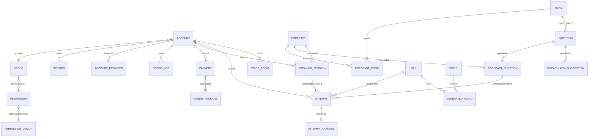

# Data Dictionary

Every MongoDB collection of the backend, what it stores, its key fields, its relations and its indexes. The source of truth is the `*.model.ts` file of each module; this document is a reading guide. How data is stored and accessed is in [data persistence](./03-data-persistence.md).

## 1. Conventions

1.1. `_id` is an `ObjectId`. Models that spread `BASE_SCHEMA_CONTENT` have `deletedAt` (soft delete, `null` when live). Models that use `BaseSchemaOptions` have `createdAt` and `updatedAt`. The field lists below do not repeat them.
1.2. Statuses and kinds are small numbers or strings from the module's `*.constants.ts`.
1.3. A field named `<x>Id` is a reference to another collection and is resolved through that module's service.
1.4. "Unique" lists unique indexes. Other indexes are listed when they matter for a query.

## 2. Entity Relationships

## 3. Identity and Access

### 3.1. `Account`

| Field | Type | Notes |
| :--- | :--- | :--- |
| `username` | string | Unique, trimmed. Taken from the email before `@` at registration |
| `email` | string | Unique, lower case |
| `password` | string or null | `select: false`; bcrypt hash; `null` for a Google-only account |
| `fullName` | string | |
| `groupId` | ref `Group` | Required. Decides the permissions |
| `avatarId` | ref `File` | |
| `isSuperAdmin` | boolean | Returned to the client; not used for authorization |
| `kind` | number | `ACCOUNT_KIND` |
| `status` | number | `STATUS`: `PENDING 0`, `ACTIVE 1`, `LOCKED -1`, `DELETED -2` |
| `selectedVoiceId` | ref `Voice` | Voice used for question audio |
| `balance` | number | Credit balance, changes only with a `CreditLog` row in the same transaction |

### 3.2. `AccountProvider`

A sign-in method linked to an account (`provider` is `google`). Fields: `accountId`, `provider`, `providerId`, `email`. Unique: `(provider, providerId)` and `(accountId, provider)`.

### 3.3. `Session`

One refresh session per user. Fields: `userId` (unique), `sid` (unique), `token` (hash of the refresh token, unique), `refreshTokenId` (unique), `expiresAt`, `lastUsedAt`, `revokedAt`, `revokedReason`, `deviceInfo`, `ipAddress`. A TTL index on `expiresAt` removes expired rows. See [authentication](./02-authentication.md).

### 3.4. `Group`, `Permission`, `PermissionGroup`

| Collection | Key fields | Unique |
| :--- | :--- | :--- |
| `Group` | `name`, `description`, `kind` (`ADMIN 1`, `USER 2`), `permissionIds` | `name` |
| `Permission` | `name`, `description`, `pCode`, `permissionGroupId` | `name`, `pCode` |
| `PermissionGroup` | `name` | `name` |

3.4.1. The meaning of `pCode` is in [security and RBAC](./01-security-and-rbac.md).

## 4. Content

### 4.1. `Forecast`

A predicted exam period. Fields: `name`, `slug` (unique), `description`, `thumbnailId`, `quarter`, `year`, `isDefault`, `status` (draft and published values in `FORECAST_STATUS`). Unique: `(quarter, year)`; only one document may have `isDefault: true`.

### 4.2. `Topic`

A speaking topic. Fields: `name`, `slug` (unique), `status`.

### 4.3. `Question`

One collection for the three IELTS parts, split by the discriminator `part` (1, 2 or 3).

| Part | Extra fields |
| :--- | :--- |
| Common | `content`, `part`, `status` |
| Part 1 | `topicId` (required) |
| Part 2 | `category` (`PART2_CATEGORY`), `bulletPoints[]` |
| Part 3 | `parentId` (ref to another `Question`, required) |

Index: `(part, status)`.

### 4.4. `ForecastTopic`

Links a topic to a forecast with an `order`. Fields: `forecastId`, `topicId`, `order`. Unique: `(forecastId, topicId)`.

### 4.5. `ForecastQuestion`

Links a question to a forecast. Fields: `forecastId`, `forecastTopicId` (required for part 1), `questionId`, `part`, `order`. Unique: `(forecastId, questionId)`. Index: `(forecastId, part)`.

### 4.6. `VocabularySuggestion`

A word or phrase suggested for a question. Fields: `questionId`, `text`, `normalizedText`, `type` (kind), `meaningVi`, `example`, `status` (pending, approved, ...), `source` (admin or AI), `level`, `occurrenceCount`, `lastOccurredAt`. Unique: `(questionId, normalizedText)`.

## 5. Practice and Scoring

### 5.1. `SpeakingSession`

A mock test or practice run of several questions. Fields: `userId`, `forecastId`, `type`, `voiceId`, `questions` (`part1` as topics with their question ids, `part2`, `part3`), `status` (`SESSION_STATUS`), `currentQuestionIndex`, `result` (`fluency`, `lexical`, `grammar`, `pronunciation`, `overall`), `startedAt`, `finishedAt`, `retryCount`, `refundedAt`, `scoringQueuedAt`.

### 5.2. `Attempt`

One recorded answer.

| Field | Notes |
| :--- | :--- |
| `userId`, `forecastQuestionId`, `audioFileId` | Owner, the question answered, the recording |
| `speakingSessionId`, `order` | Set for a mock test; `null` for a single practice |
| `mode` | `practice` or `mock` |
| `part` | 1, 2 or 3 |
| `status` | `PENDING 0`, `PROCESSING 1`, `DONE 2`, `FAILED 3` |
| `scores` | `overall`, `fluency`, `pronunciation`, `lexical`, `grammar` (bands) |
| `analysisMeta` | `startedAt`, `finishedAt`, `currentStage`, `failedStage`, `error`, `warnings` |
| `retryCount`, `refundedAt` | Retry counter; set once when the credit is refunded |
| `isPublic` | Shared result link on or off |
| `analysisProfile`, `analysisVersion` | `fast`, `standard` or `premium`; pipeline version |
| `transcriptPreview`, `duration` | |

Unique (only when `speakingSessionId` is set): `(speakingSessionId, order)` and `(speakingSessionId, forecastQuestionId)`. Other indexes: `(userId, forecastQuestionId, createdAt)` and `(forecastQuestionId, status, isPublic, scores.overall)` for the public leaderboard.

### 5.3. `AttemptAnalysis`

The detailed result of one attempt (1 to 1, `attemptId` unique). Sections: `providers` (name, model and version of speech to text, pronunciation and evaluator), `transcription` (transcripts and segments), `pronunciationAssessment` (scores, words, syllables, phonemes), `speechAnalysis` (fluency metrics, pauses) and `evaluation` (per-criterion band, strengths, limitations and, for lexical and grammar, issues aligned to word indexes). The stages that fill it are in [AI scoring](../04-business-logic/01-ai-scoring.md).

## 6. Billing

### 6.1. `CreditLog`

The ledger. One row per balance change. Fields: `userId`, `type` (`plus` or `minus`), `amount`, `description`, `descriptionKey`, `descriptionMetadata`, `refType` (`payment`, `usage`, `manual`, `refund`), `refId`, `balanceBefore`, `balanceAfter`, `createdAt`. Index: `(userId, createdAt)`.

### 6.2. `CreditPackage`

A purchasable bundle. Fields: `amount` (price), `points` (credit), `isActive`.

### 6.3. `Payment`

A PayOS payment. Fields: `userId`, `orderCode` (unique), `externalId`, `packageId`, `amount`, `points`, `method`, `provider`, `status` (`pending`, `success`, `failed`, `canceled`, `expired`), `expiredAt`, the bank transfer data (`qrCode`, `accountName`, `accountNumber`, `bin`, `description`), `webhookVerified`, `webhookReceivedAt`, `retryCount`, `paidAt`, `createdAt`. Indexes: `(userId, createdAt)`, `(status, expiredAt)`. The `orderCode` index is declared twice (finding F15). `webhookVerified` and `retryCount` are written or defaulted but never read.

## 7. Files and Audio

### 7.1. `File`

Metadata of an uploaded file, split by the discriminator `kind`.

| Field | Notes |
| :--- | :--- |
| `kind` | `audio` or `image` |
| `provider` | Storage provider (Cloudinary) |
| `storageKey` | Unique key at the provider |
| `url`, `fileName`, `fileSize`, `mimeType`, `checksum` | |
| `status`, `ownerId` | |
| Audio | `duration`, `transcript`, `aiAudioUrl`, `aiStorageKey` |
| Image | `width`, `height` |

### 7.2. `Voice`

A text-to-speech voice. Fields: `name` (unique), `voiceCode` (unique), `gender`, `locale`, `speed` (0.5 to 2), `pitch` (-20 to 20), `sampleAudioFileId`, `status`, `isDefault`. Only one voice may be the default.

### 7.3. `GeneratedAudio`

A cache of generated question audio. Fields: `text`, `normalizedText`, `voiceId`, `fileId`, `cacheKey` (unique), `lastUsedAt`, `status`. The same text and voice reuse the stored file.

## 8. Voice Rooms

### 8.1. `VoiceRoom`

A practice room for several speakers. Fields: `title` (at most 100), `topicType`, `level`, `maxParticipants` (2 to 10), `isPrivate`, `pinCode` (plain text, finding F7), `hostId`, `status`, `startedAt`, `endedAt`, `speakingPolicy`, `questionPinPolicy`, `welcomeMessage`, `pinnedQuestionId`. Indexes: `(status, createdAt)`, `(hostId, status)`.

## 9. Not Stored in MongoDB

9.1. Pending registrations, OTP codes, reset tokens, OAuth state, socket tickets and rate-limit counters live in Redis with a time limit ([data persistence](./03-data-persistence.md), section 6).
