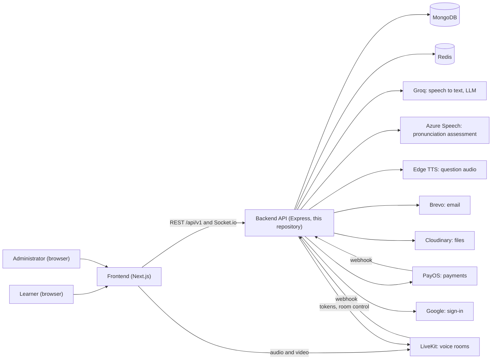
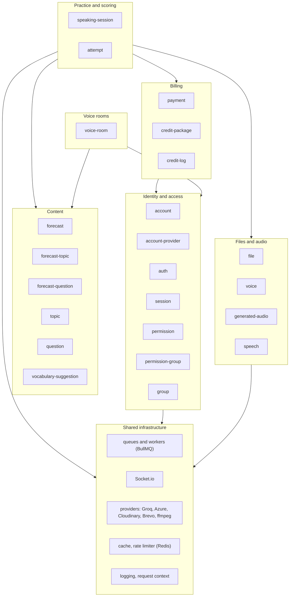
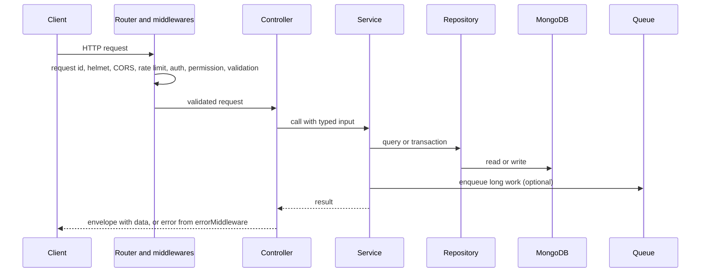
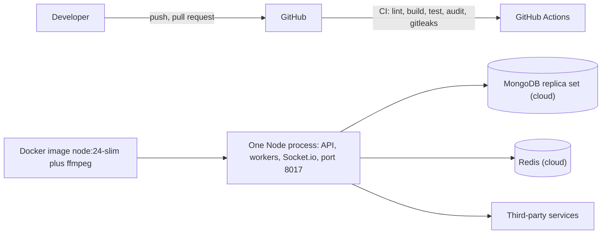

# System Diagrams

Four views of the system: context, components, request and scoring flow, and deployment. They describe the code of the branch this document ships with. The data model has its own diagram in [the data dictionary](./06-data-dictionary.md); the scoring and payment sequences are in [AI scoring](../04-business-logic/01-ai-scoring.md) and [payment and credit](../04-business-logic/02-payment-and-credit.md) and are not repeated here. The long-term target (microservices) is in `architecture_roadmap.md` in the workspace folder.

## 1. Context

Who and what the system talks to.

1.1. The browser talks only to the frontend and, for voice rooms, to LiveKit. Every third-party key stays in the backend ([configuration](../09-operations/01-configuration-reference.md), section 7).
1.2. Payment and LiveKit call the backend back through a webhook (`POST /payment/webhook/payos`, `POST /voice-room/webhook`).

## 2. Components

The modules of `src/modules`, grouped by domain, and the shared parts.

2.1. An arrow means "uses the service of". Several arrows break the module rules (a module reading another's collection, finding F1); the target layout and the rules are in [layers and modules](../07-development-guides/02-layers-and-modules.md).
2.2. `mail` and `speech` are thin modules; mail is sent through the mail queue.

## 3. Layers Inside One Request

## 4. Deployment

### 4.1. Today

4.1.1. The backend is one container: HTTP API, BullMQ workers and Socket.io run in the same process (see [queues and realtime](./05-queues-and-realtime.md)). The image runs as the non-root `node` user and has a `HEALTHCHECK` on `/health`.
4.1.2. MongoDB and Redis are external. `docker-compose.dev.yaml` starts only the API.
4.1.3. The CI workflow is in `.github/workflows/ci.yml`. There is no automatic deploy yet.

### 4.2. Planned

4.2.1. A staging environment reachable from outside, with the backend and frontend images built by the pipeline, secrets in the platform's secret store, a health check after each deploy and a rollback to the previous image. The host, registry and trigger are decided in the `ci-cd-staging` ticket; this section is rewritten when they exist.
