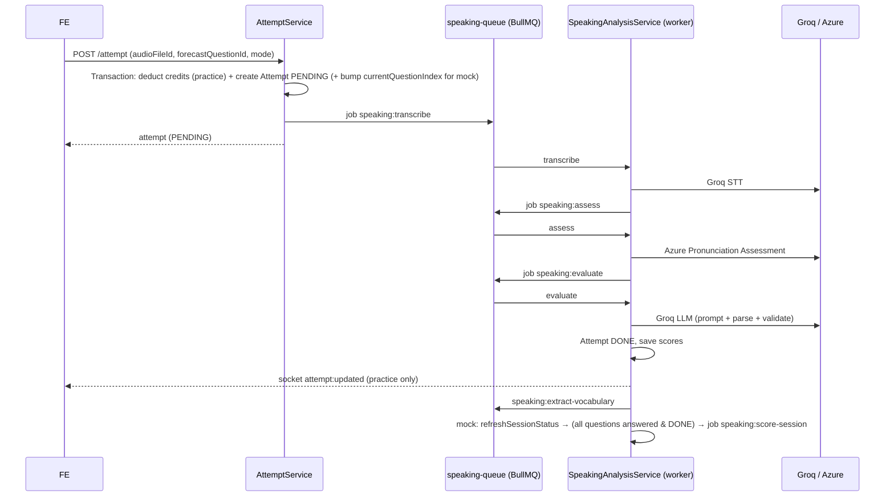

# AI Scoring Flow

> **Status: as-is.** This document describes how the code works today, including behavior that is a known defect or an undecided product rule. It is not an approved rule set. The target design is in [`specs/architecture-refactor/design.md`](../specs/architecture-refactor/design.md).

> A learner's spoken answer (one practice question, or each question in a mock test) is scored by 3 chained stages on BullMQ: **transcribe → assess → evaluate**. Mock tests add a **score_session** stage that computes the band for the whole session.

## Context

- **Practice:** the learner answers one question. Credits are deducted when the attempt is created (`POST /api/v1/attempt`).
- **Mock test:** the learner creates a speaking session (`POST /api/v1/speaking-session`). Credits for the whole session are deducted once, at creation. Each answer is then an attempt with a `speakingSessionId`.
- Prices are in `CREDIT_COST` (`src/modules/billing/wallet/credit-log.constants.ts`), computed by `calculateCreditCost()`.

## Flow

| Stage | Job | What it does | Writes to |
| :--- | :--- | :--- | :--- |
| transcribe | `speaking:transcribe` (priority 1) | Groq STT on `aiAudioUrl ?? url`. Normalizes the text with `normalizeForAssessment` | `Attempt.transcriptPreview`, `duration`; `AttemptAnalysis.transcription.*` |
| assess | `speaking:assess` | Azure Pronunciation Assessment, using the normalized transcript as the reference. `SpeechMapper` computes `speechAnalysis` (fluency metrics, etc.) and builds the display and scoring transcripts | `AttemptAnalysis.pronunciationAssessment`, `speechAnalysis`, `transcription.scoringTranscript` |
| evaluate | `speaking:evaluate` | `LLMEvaluator`: `evaluator-prompt.builder` → Groq LLM → `evaluator-response.parser` (validation). Invalid output throws `EvaluatorValidationError`, which triggers a retry | `AttemptAnalysis.evaluation`; `Attempt.scores` + `status = DONE` |
| vocabulary | `speaking:extract-vocabulary` | Extracts suggested vocabulary from the scored answer. Failures here do not affect the score | `vocabulary-suggestion` module |
| score_session | `speaking:score-session` | Mock only. See the formula below | `SpeakingSession.result`, `status = COMPLETED` |

Each stage enqueues the next one, and the next job carries the data it needs from the previous stage.

**Two collections:**
- `Attempt` holds only lightweight data for list views: status, scores, `analysisMeta`.
- `AttemptAnalysis` (1-to-1 via `attemptId`) holds the heavy data: transcripts, per-word and per-phoneme results, the evaluation, raw responses.

**Mock session band formula** (`scoreSession`):
1. For each criterion (fluency, pronunciation, lexical, grammar), average the scores within each Part.
2. Average across the Parts that have data.
3. `overall` = the mean of the 4 criteria, rounded to the nearest 0.5. Each criterion is also rounded to 0.5.

## Statuses

- `Attempt.status`: `PENDING 0 → PROCESSING 1 → DONE 2 | FAILED 3`. The current stage is in `analysisMeta.currentStage`.
- `SpeakingSession.status`: `NOT_STARTED 0 → IN_PROGRESS 1 → PROCESSING 2 → COMPLETED 3 | FAILED 4`.
  - The session moves to `PROCESSING` when the last answer is submitted.
  - `refreshSessionStatus()` runs after each attempt finishes or fails. Any FAILED attempt makes the session FAILED. When every question is answered and all attempts are DONE, it enqueues `score-session`. The `scoringQueuedAt` flag prevents enqueueing twice.

## Realtime (Socket.io)

| Event | When | FE listener |
| :--- | :--- | :--- |
| `attempt:updated` | Every stage change, success or failure. **Practice only** | `practice/[questionId]/_components/practice-history.tsx` |
| `mock-test:updated` | Session COMPLETED or FAILED | `account/_components/mock-test-history-tab.tsx` |

Events are sent to the `userId` room. The constants are defined in `src/modules/assessment/assessment.constants.ts`, and the FE keeps a copy in `src/constants/constants.ts`. The two must stay in sync.

## Errors, retries and refunds

1. **Automatic retry:** transcribe, assess and evaluate use `attempts: 3` with 5s exponential backoff. Only the final attempt calls `_markAttemptFailed()`, which records `failedStage` and `error`.
2. **Manual retry** (triggered by the user):
   - Practice: `POST /attempt/:id/retry`.
   - Mock: retrying the session reruns every FAILED attempt.
   - Processing resumes **from the stage that failed** (`analysisMeta.failedStage`), reading that stage's input from `AttemptAnalysis`.
   - Each attempt or session can be retried at most `MAX_RETRY = 1` time.
3. **Automatic refund:** only happens when scoring **fails after the manual retry has been used** (`retryCount >= MAX_RETRY`).
   - Practice: refunded per attempt.
   - Mock: the whole session is refunded (`checkAndRefund`).
   - The refund runs in a transaction. The `refundedAt: null` condition makes it idempotent, so it never refunds twice. A `REFUND` credit log is written at the same time.
   - A refunded attempt or session can no longer be retried.

> ⚠️ The first failure does **not** refund credits, because the user still has a retry left. If they never press retry, the credits are never refunded.

## Related code

- `src/modules/practice/attempt/attempt.service.ts`: creating attempts, retries.
- `src/modules/assessment/speaking-analysis.service.ts`: the logic of each stage, session scoring, practice refunds.
- `src/modules/practice/mock-test/speaking-session.service.ts`: creating sessions (credit deduction), `refreshSessionStatus`, `checkAndRefund`, `retrySession`.
- `src/modules/practice/jobs/speaking.producer.ts`: retry settings for each job.
- `src/modules/practice/jobs/speaking.consumer.ts`: job dispatch (worker `concurrency: 1`).
- `src/modules/assessment/adapters/{stt,speech-assessment,evaluator,llm}`.

## See also

- [Payment & credits](./02-payment-and-credit.md)
- [Architecture overview](../01-introduction/01-system-overview.md)
