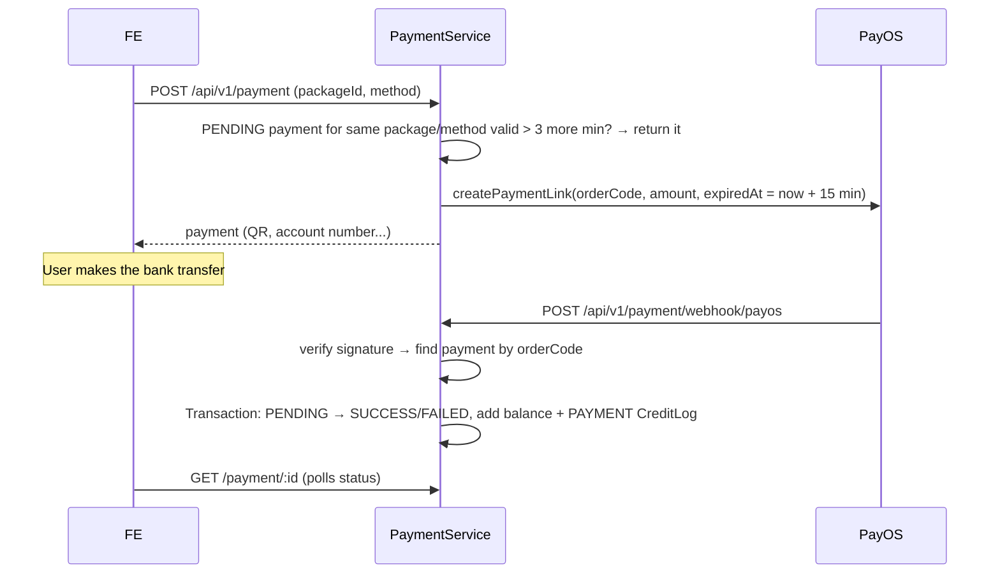

# Payment & Credit Flow

> **Status: as-is.** This document describes how the code works today, including behavior that is a known defect or an undecided product rule. It is not an approved rule set. The target design is in [`specs/architecture-refactor/design.md`](../specs/architecture-refactor/design.md).

> Learners buy credit packages through PayOS (QR bank transfer). Credits are added when PayOS calls the webhook to confirm success. Credits are deducted for practice and mock tests, and refunded when scoring fails.

## Data model

| Collection | Role |
| :--- | :--- |
| `CreditPackage` | A package for sale: `amount` (VND), `points`, `isActive` |
| `Payment` | One payment: `orderCode` (unique), `status`, `expiredAt`, QR details, `webhookVerified` |
| `Account.balance` | The current credit balance. Changes only through `AccountService.addBalance` / `deductBalance` |
| `CreditLog` | The ledger. Each change records `type` (`plus`/`minus`), `amount`, `balanceBefore`/`balanceAfter`, `refType` (`payment` / `usage` / `refund` / `manual`) and `refId` |

**Rule:** every change to `balance` must write a `CreditLog` **in the same transaction**.

## Buying credits

- `orderCode = Date.now() * 100 + random(0..99)`.
- `returnUrl` / `cancelUrl` point to `${APP_URL}/payment/result` and `/payment/cancel`.
- An overdue `PENDING` payment is switched to `EXPIRED` **lazily**, only when someone calls `GET /payment/:id`. There is currently no background job that sweeps expired payments.

## Webhook safeguards

1. **Signature:** `payos.provider.ts` calls `client.webhooks.verify()`. A bad signature throws, and the webhook is ignored.
2. **Status:** only `PENDING` payments are processed. Redelivered webhooks for already-processed orders are ignored.
3. **Amount:** if `amount` does not match, it logs `[Webhook Alert]` and adds no credits.
4. **Idempotency:** `updateOne({ _id, status: PENDING })` inside the transaction. If two webhooks arrive at once, only one request can update the payment.
5. The controller **always returns 200**, even on errors, so PayOS does not keep resending. The consequence is that webhook errors are visible only in the logs.

## Deducting credits

| When | Where | Cost |
| :--- | :--- | :--- |
| Creating a practice attempt | `AttemptService.createNew` | `CREDIT_COST.PRACTICE.PART_n`: P1 5, P2 20, P3 10 |
| Creating a mock session | `SpeakingSessionService.createNew` | `CREDIT_COST.MOCK`: P1 40, P2 20, P3 50; full test 100 |

- Attempts inside a mock test are **not** charged again, since the session was already charged.
- `deductBalance` fails with `INSUFFICIENT_BALANCE` (400) when the balance is too low. The transaction then rolls back, and no attempt or session is created.

## Refunds

Refunds happen automatically when scoring fails **after the manual retry has been used**. Details are in the [AI scoring flow](./01-ai-scoring.md#errors-retries-and-refunds).
- The `refundedAt` flag on Attempt or SpeakingSession, combined with a `refundedAt: null` condition in the update, prevents refunding twice.
- A `CreditLog` is written with `refType: refund` and `refId` set to the attempt or session.

## Related code

- `src/modules/billing/payment/`: `payment.service.ts`, `adapters/payos.provider.ts`, `payment.constants.ts` (statuses, `BUFFER_TIME`, `EXPIRED_DURATION`).
- `src/modules/billing/package/`, `src/modules/billing/wallet/` (`credit.util.ts`, `CREDIT_COST`).
- `src/modules/account/account.service.ts`: `addBalance`, `deductBalance`.
- Env: `PAYOS_CLIENT_ID`, `PAYOS_API_KEY`, `PAYOS_CHECKSUM_KEY`, `APP_URL`.

## See also

- [AI scoring flow](./01-ai-scoring.md)
- [Architecture overview](../01-introduction/01-system-overview.md)
