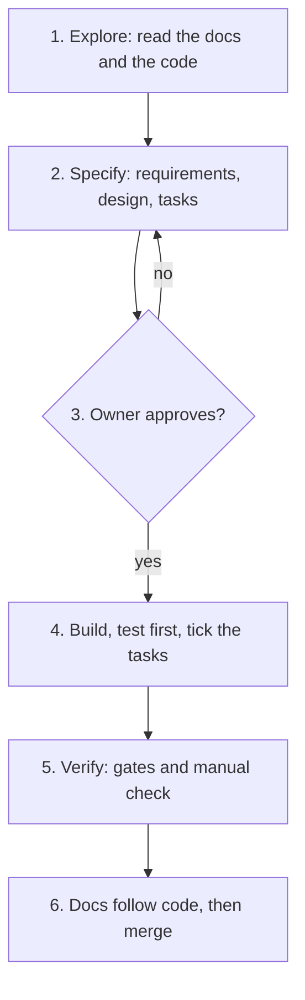

# Feature Design Guide

The lifecycle every feature or structural change follows in Speprove: understand, specify, get approval, build in a fixed order, verify. It applies to the backend and, for a change that spans both, to the frontend.

## 1. Lifecycle

1.1. Nothing is edited, installed or committed before step 3. Reading, searching, type-checking and running tests are allowed at any time.
1.2. Step 3 needs an explicit "approved" from the owner. A question or a comment is not approval.

## 2. When a Spec Is Needed

| Kind | Use when | Result |
| :--- | :--- | :--- |
| **Spec** | A feature, a change with design decisions, a change across modules or across backend and frontend | `docs/specs/<name>/requirements.md`, `design.md`, `tasks.md` |
| **Task list** | A small or mechanical change (dependency upgrade, dead-code removal, a bug fix, a measurement) | A table of tasks with acceptance criteria and evidence, approved in chat and kept as `tasks.md` alone in `docs/specs/<name>/` (the pull request description links to it) |
| **Docs only** | A document change | No spec; the pull request description lists what changed |

## 3. Explore

3.1. Read [the system overview](../01-introduction/01-system-overview.md), the flow document of the area ([AI scoring](./01-ai-scoring.md), [payment and credit](./02-payment-and-credit.md)), and the rules in [layers and modules](../07-development-guides/02-layers-and-modules.md).
3.2. Read the code the change touches. Do not rely on memory or on a document that may be stale.
3.3. If the business logic of the area is not documented, write that document first (or in the same change), then design.

## 4. Specify

### 4.1. `requirements.md`

4.1.1. **Goal:** who (actor), what, why, in two or three sentences.
4.1.2. **Context:** the current state in numbered clauses, then the **decisions** already made, each numbered so a later document can cite it.
4.1.3. **User stories:** "As a ..., I want ..., so that ...".
4.1.4. **API contract consumed or provided:** method, path, request, response, errors. Do not add an endpoint the interface does not use.
4.1.5. **Acceptance criteria** `AC1`, `AC2`, ...: each one observable and checkable (a status, a stored value, a screen state). At least one negative case.
4.1.6. **Non-functional criteria** that apply, with a number: response time, concurrency, security rule.

### 4.2. `design.md`

4.2.1. **Approach** in a short paragraph, and the **alternatives considered** with the reason each was rejected.
4.2.2. **Changes by file or module**, numbered, each pointing to the acceptance criteria it serves.
4.2.3. **Sequence diagram** (Mermaid) of the main flow across client, controller, service, repository, queue.
4.2.4. **Security and authorization:** permission required, how ownership of a resource is checked, what a foreign resource returns.
4.2.5. **Concurrency and idempotency:** what happens when the request runs twice or in parallel; where a transaction or a unique index protects the invariant.
4.2.6. **Data changes:** new fields, indexes, a migration or copy script, and what happens to existing data.
4.2.7. **Frontend impact** and the order of the two changes.

### 4.3. `tasks.md`

4.3.1. A list of small tasks, each with the criterion it serves (`AC`) and the **evidence** that will prove it: `test` (name the file), `code` (read in the code only) or `none`.
4.3.2. Order: **test of the current behavior** (for a refactor) or **failing test** (for a new behavior), then the change, then the cleanup.
4.3.3. The last tasks are the local gates and a **manual check** with the steps and the expected result.
4.3.4. The header carries the status of the spec and the date of approval.

## 5. Build

5.1. A new backend feature is built in this order: model and indexes, repository, DTOs and validation, mapper, service, controller and route, then tests. For each step the test of the behavior it adds is written first.
5.2. One concern per commit. A move, a rename and a logic change are separate commits. Commits are Conventional Commits with a scope.
5.3. Tick the tasks in `tasks.md` as they are done, in the same commit as the work.
5.4. The frontend follows the same chain: types, API config, API request, query hook, components, route.

## 6. Verify

6.1. Gates, all green: `pnpm lint`, `pnpm build`, `pnpm test` (and the frontend's `pnpm lint`, `pnpm type-check`, `pnpm build`).
6.2. The manual check of `tasks.md` is done by the owner or shown with output.
6.3. Report what is not verified, in the pull request description, instead of leaving it out.

## 7. Docs Follow Code

7.1. A document that the change makes wrong is corrected in the same pull request ([guidelines](../docs-update-guidelines.md), section 3.2).
7.2. A new document is registered in [layout-and-index.md](../layout-and-index.md).
7.3. When the change fixes an entry of "Known Deviations" in [the error code registry](../08-integration-contracts/02-error-codes.md), remove it there.
