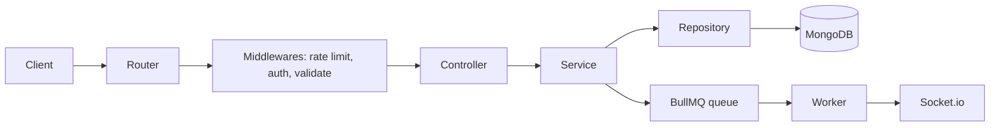

# Layers and Modules

How a request moves through the code, what each layer may do, and the rules that keep modules separable. Speprove is a **modular monolith**: one deployable, with modules that follow rules so that one of them can later be moved into its own service. The target microservice architecture is in `architecture_roadmap.md` in the workspace folder; the module layout the refactor is moving toward is in [the architecture refactor design](../specs/architecture-refactor/design.md).

## 1. Request Flow

1.1. The route file lists the middlewares in order: rate limit, `authMiddleware.isAuthorized`, `authMiddleware.hasPermission(...)`, `validateMiddleware(schema)`, then `bindHandler(Controller, 'method')`.
1.2. Routes are mounted under `/api/v1` in `src/routes/index.ts`.
1.3. Long work (speech to text, pronunciation assessment, LLM scoring, mail) goes through a BullMQ queue. Workers run in `src/infrastructure/workers/consumers` and report progress through Socket.io. The stages are in [the AI scoring flow](../04-business-logic/01-ai-scoring.md).

## 2. What Each Layer May Do

| Layer | File | Does | Does not |
| :--- | :--- | :--- | :--- |
| Route | `*.route.ts` | Declares path, method, middleware order | Contain logic |
| Validation | `*.validation.ts` | Zod schema for `body`, `params`, `query` | Check business rules or the database |
| Controller | `*.controller.ts` | Reads `req.validated` and `req.user`, calls one service method, answers with `ResponseTransformer` | Catch errors, query the database, hold business rules |
| Service | `*.service.ts` | Business rules, transactions, calls repositories and other modules' services, enqueues jobs | Read `req` or `res`, build HTTP responses |
| Repository | `*.repository.ts` | Queries and writes of its own collection, extends `BaseRepository` | Contain business rules, touch another module's collection |
| DTO and mapper | `*.dto.ts`, `*.mapper.ts` | Shape of data that enters and leaves the module | Contain logic beyond mapping |
| Model | `*.model.ts` | Mongoose schema, indexes | Be imported by another module |
| DI | `*.di.ts` | Registers interface tokens in `register<Module>Module` | Contain logic |

2.1. Dependency injection uses `tsyringe`. Classes use `@singleton()` or `@injectable()`. A repository is registered against a token in `src/common/constants/di.tokens.ts` and injected by that token. `src/bootstrap/container.ts` calls every module's register function.
2.2. A service gets other modules and providers through the constructor, as an interface when one exists.
2.3. Controllers are bound with `bindHandler`, which wraps the method so a thrown error reaches `errorMiddleware`.

## 3. Module Rules

These come from `architecture_roadmap.md` and apply to every change.

3.1. **A module touches only its own models.** Do not import another module's model, and do not `.populate()` into its collection. Keep the other module's id, then ask that module's service, or merge the data in the mapper.
3.2. **Cross-module calls go through the other module's interface.** Inject it by constructor. Do not import another module's repository, controller or internal helpers.
3.3. **Asynchronous work between modules uses a BullMQ job**, not an in-process event bus (the event bus was removed because nothing used it). Events that carry money, score or exam state must be idempotent.
3.4. **Data crosses a module boundary as a DTO**, never as a Mongoose document.
3.5. **No circular dependency.** Do not hide one with `delay()`; move the shared piece to a third module or to `core`.

Known violations that the refactor removes are listed in section 11.1 of [the architecture refactor design](../specs/architecture-refactor/design.md) (findings F1, F8, F9, F28).

## 4. Adding a Module

4.1. Create `src/modules/<name>/` with the files of section 2 that the module needs. A module without HTTP has no route, controller or validation.
4.2. Register the repository token in `di.tokens.ts` and a `register<Name>Module` function in `<name>.di.ts`; call it from `src/bootstrap/container.ts`.
4.3. Mount the router in `src/routes/index.ts` with a singular resource name.
4.4. Add the model's indexes in the model file. Add the permissions it needs (section 5) to the seed.
4.5. Add an API test for the endpoints ([testing strategy](../06-testing/01-testing-strategy.md)), then update [layout-and-index.md](../layout-and-index.md).

## 5. Authorization

5.1. `authMiddleware.isAuthorized` reads the access token from the `accessToken` cookie or the `Authorization: Bearer` header and sets `req.user`. `isAuthorizedOptional` does the same but lets a guest through.
5.2. `authMiddleware.hasPermission('RESOURCE:ACTION[:SCOPE]')` checks `req.user.permissions`. A user permission with scope `ALL` satisfies a required scope. A missing permission answers 403.
5.3. A route that changes data or lists data of other users has a `hasPermission` check. A route that is public says so in a comment.
5.4. A resource that belongs to a user is checked in the service against `req.user._id`.

## 6. Configuration of the Process

6.1. `src/app.ts` builds the Express app (`createApp`), so tests can start it without a port. `src/index.ts` starts queues, workers and the HTTP server, and stops them in order on shutdown.
6.2. The probes `/health` and `/ready` are served outside `/api/v1`.
