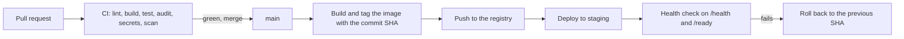

# CI/CD and Quality Gates

What runs automatically on every change, what is planned, and what decides that a change may merge or be deployed. The workflow file is `.github/workflows/ci.yml`. The way a change is written and tested is in [coding standards](../07-development-guides/01-coding-standards.md) and [the testing strategy](../06-testing/01-testing-strategy.md).

## 1. Pipeline Today

The workflow `CI` runs on every pull request and on every push to `main`. One job (`check`, 20 minutes at most) runs these steps in order; a failing step fails the job.

| Step | Command or action | Purpose |
| :--- | :--- | :--- |
| 1 | `actions/checkout` with full history | Source and history (the secret scan reads history) |
| 2 | `pnpm/action-setup`, `actions/setup-node` with `.nvmrc`, `pnpm install --frozen-lockfile` | Reproducible install |
| 3 | `pnpm lint` | ESLint and Prettier rules |
| 4 | `pnpm build` | TypeScript compile |
| 5 | cache of the MongoDB binary, `pnpm test:coverage` | Unit and API tests with a coverage report |
| 6 | Coverage summary and `actions/upload-artifact` | Writes the percentages to the job summary and keeps `lcov.info` and `coverage-summary.json` |
| 7 | `pnpm deps` (`dependency-cruiser`, rules in `.dependency-cruiser.cjs`) | Reports cycles, cross-module imports and imports from `core/` or `config/` into a module; warnings only for now |
| 8 | `pnpm audit --audit-level=high` | Fails on a high or critical advisory |
| 9 | `gitleaks/gitleaks-action` | Secret scan over the history |
| 10 | `SonarSource/sonarqube-scan-action` (only when the `SONAR_TOKEN` secret exists) | Sends the code and the coverage report to SonarQube Cloud; reports only, the quality gate does not fail the build yet |

A second job, `image`, runs after `check`: it builds the Docker image, which proves that the `Dockerfile` still builds. It does not scan the image: the Trivy step was removed on 2026-11-28 because the action's version tags were rewritten in the March 2026 supply chain incident and the tag used here no longer resolves. An image scan is left for the registry of the cloud host (to be decided in the `ci-cd-staging` ticket).

1.1. Concurrent runs of the same branch cancel the older one. The workflow has read-only repository permission.
1.2. **Status:** the workflow is written and has not run on GitHub yet; the first run may need fixes. The coverage run and the duplication gate were run locally and pass; the image job was **not** run locally (the root disk of the development machine is too small for the build). The frontend has no workflow.

## 2. Quality Gates

| Gate | What it adds | Status |
| :--- | :--- | :--- |
| Coverage | `@vitest/coverage-v8`, script `pnpm test:coverage`, report in the job summary and as an artifact | **Done** in `ci/quality-gates`. Line coverage 22.03 percent on 2026-11-26 |
| Duplication | Measured by SonarQube Cloud (the `jscpd` gate was dropped on 2026-11-28 because Sonar measures duplication too; 1.11 percent on 2026-11-26 with `jscpd`) | **Done** |
| Dependency updates | `.github/dependabot.yml` for npm, GitHub Actions and Docker, weekly; minor and patch updates of npm and of the GitHub Actions are grouped into one pull request each, a major update stays a pull request of its own, and a major update of the `node` image is ignored (the Node version is changed on purpose) | **Done** (file added); the alerts must also be enabled in the repository settings by the owner |
| Image build | Docker build in the `image` job | **Done**, not run on GitHub yet. The image scan (Trivy) was dropped, see section 1 |
| Static analysis service | SonarQube Cloud, run from the workflow so that the coverage report reaches it: `sonar-project.properties` and one workflow step | **Written, not run**: the project is imported and the automatic analysis is switched off on 2026-11-28; the owner saves the token as the secret `SONAR_TOKEN` and sets the repository variables `SONAR_ORGANIZATION` and `SONAR_PROJECT_KEY`; until then the step is skipped and Sonar analyzes nothing. The quality gate of the new code includes coverage, so it may need a relaxed copy while the coverage is low |
| Frontend CI | A workflow for `speprove-fe`: install, lint, type check, build | **Open**: next ticket step, in the frontend repository |
| Branch protection | `main` requires a pull request and a green CI; direct pushes refused | **Open**: owner action in the repository settings |
| Commit lint | Conventional Commits checked on pull requests | **Open** |

2.1. A gate is added only with a first run that is green; a gate that is red from day one is ignored.
2.2. Thresholds that fail a pull request: the CI steps above, no new `critical` or `blocker` static-analysis issue, and coverage of the core modules not below the agreed target ([test plan](../06-testing/02-test-plan.md), section 6).

## 3. Delivery (Planned)

3.1. **Versioning:** an image is tagged with the commit SHA; a release is a SHA.
3.2. **Rollback:** redeploy the previous SHA. The script and the steps are written when the host is chosen.
3.3. **Secrets:** stored in the platform's secret store (GitHub Environments for CI and deploy); never in the repository ([configuration](./01-configuration-reference.md), section 8).
3.4. **Monitoring after deploy:** the health check above, an uptime check on `/health` with an alert, and logs collected in one place. The log format is JSON with a request id on each line.
3.5. **Record:** every deploy is recorded (SHA, time, result) so the deployment history can be shown.
3.6. The host, the registry, the trigger and the monitoring tool are decided in the `ci-cd-staging` ticket and written here when they exist.

## 4. Rules for a Pull Request

4.1. One concern per pull request; the description lists the acceptance criteria and the evidence ([feature design guide](../04-business-logic/03-feature-design-guide.md), section 4.3).
4.2. The pull request is green before merge. A flaky test is fixed or isolated, not rerun until it passes.
4.3. A change that makes a document wrong updates the document in the same pull request ([guidelines](../docs-update-guidelines.md), section 3.2).
4.4. A merge uses a merge commit when branches are chained, so the commits of the later branches stay identical.
