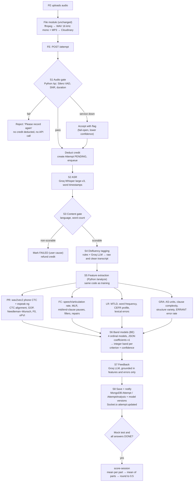
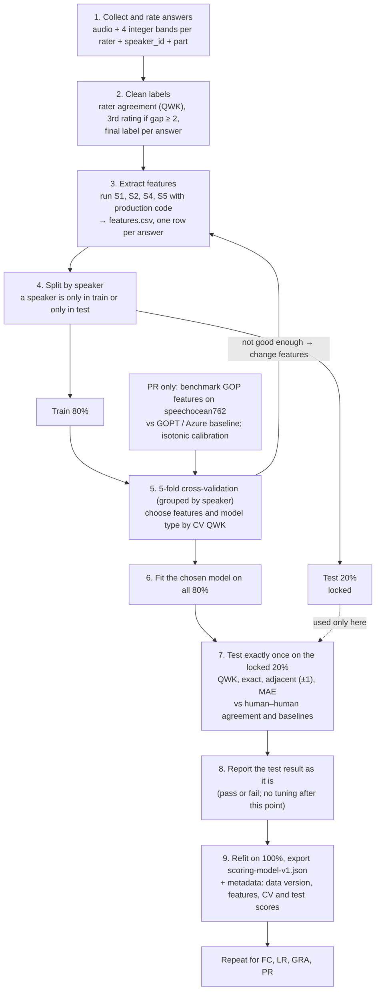

# Scoring Pipeline v2: Design

> Status: draft for review (ticket **SCR-0**, see [backlog](../../plan/backlog.md)).
> Replaces the scoring part of the current flow described in [AI scoring](../../04-business-logic/01-ai-scoring.md).

## 1. Why change

The current pipeline is `Groq Whisper → Azure Pronunciation Assessment → Groq LLM`. The LLM decides the FC, LR and GRA bands directly, and `rule-based-scorer.service.ts` maps Azure scores to the PR band with hand-set weights (0.45 / 0.35 / 0.20).

Problems:
- **Black box.** Nobody can explain why an answer got a band, and the LLM does not give the same band twice for the same answer.
- **No validation.** There is no labelled data, so we cannot say how close the bands are to a human examiner.
- **Azure** is the most expensive and slowest call and gives less detail than we need (no "which phone was said instead of which").

## 2. Goals and non-goals

**Goals**
1. Every band is computed by a **validated, explainable model** from **measured features**, following the standard architecture of automated speaking assessment: speech recognition → feature extraction → scoring model (Zechner et al., 2009).
2. Every feature maps to a phrase of the public **IELTS Speaking Band Descriptors** (construct validity).
3. Accuracy is **measured** against human raters with the standard metrics (Williamson, Xi & Breyer, 2012).
4. The pipeline runs in production: acceptable latency on a CPU server, acceptable cost, licences that allow use.

**Non-goals (v2)**
- Training a neural end-to-end scorer (needs thousands of labelled answers; see §11).
- Fine-tuning wav2vec2 on Vietnamese speakers.
- Claiming official IELTS scores. Bands are labelled "estimated band based on the public IELTS Speaking Band Descriptors".

## 3. Key decisions

| # | Decision | Reason |
| :--- | :--- | :--- |
| D1 | **Hybrid**: keep APIs where they are stronger and cheaper (Groq Whisper, Groq LLM); self-host the Azure replacement and all feature extraction | Self-hosting Whisper-large or an LLM needs a GPU; pronunciation scoring is where control and explainability matter most |
| D2 | **The LLM never outputs a band.** It only extracts structure (disfluencies, minimal grammar corrections) and writes feedback from measured features | Removes the black box from scoring |
| D3 | **Unit of scoring = one answer.** Mock-test session band = aggregate of answer bands (existing `scoreSession` formula) | The app is practice-first (one attempt per question); per-answer scoring lets a mock test be scored while the learner is still answering |
| D4 | **Four models, one per criterion** (FC, LR, GRA, PR). Test part is a feature, not a separate model | IELTS gives one band per criterion; 12 models (criterion × part) would split already small data |
| D5 | **Ordinal logistic regression** as the main model; linear regression and gradient boosting as comparisons | Bands are ordered categories; the model is interpretable and works with a few hundred samples |
| D6 | **Audio gate (VAD) runs in `POST /attempt`, before `deductBalance`**, not in the upload module | No credit and no Groq cost for silent or broken audio, and the upload module stays a generic file store |
| D7 | Model coefficients are exported as **versioned JSON** and applied in the BE | An ordinal logit is a few numbers; no Python runtime or scikit-learn version pin is needed for inference |
| D8 | Azure stays behind a feature flag until the pronunciation benchmark (§9.2) passes | Safe migration and a baseline for the thesis |

## 4. Scoring flow (one answer)



Notes:
- **Latency.** Each answer is processed as soon as it is submitted, while the learner answers the next question. After the last answer the learner waits only for that answer plus the session aggregation (milliseconds). Worker `concurrency: 1` must be raised or workers split out (ticket PERF-3), otherwise answers from many users queue behind each other.
- **Practice vs mock.** Both use the same four models. Mock tests add only the aggregation step that already exists.
- **Bands.** Each criterion band is an integer, as in IELTS. Only aggregated bands are rounded to 0.5.
- **Confidence.** A band is labelled "estimated" when the audio was flagged, the answer is very short, or mean ASR confidence is low (ASR errors propagate into every feature; Knill et al., 2018).
- **Errors and retries** follow the current rules (3 automatic retries per stage, retry from the failed stage, refund after the manual retry fails). User-caused rejections (S1, S3) are separate from system failures.

## 5. Stages in detail

### S1 Audio gate (synchronous, before credit)
- **Silero VAD** finds speech segments; we compute total speech time, silence ratio and an SNR estimate.
- Reject only when the answer certainly cannot be scored (almost no speech, unreadable file). Borderline cases are accepted with a flag. Thresholds are tuned on collected data.
- Automated speaking systems filter non-scorable responses before scoring (Zechner et al., 2009); doing it before charging is our product choice.

### S2 ASR
- **Groq `whisper-large-v3`** (already used in `groq-stt.provider.ts`), with `response_format: verbose_json` and `timestamp_granularities: ['word']` for word confidence. Groq's docs disagree on word-timestamp support, so this must be tested.
- The existing prompt with "Um, uh, I think…" stays, to stop Whisper from deleting fillers. We measure how many fillers are still lost on ~30 hand-transcribed answers.
- Precise word and phone timings come from the CTC alignment in S5 (PR branch), not from Whisper.
- CrisperWhisper (verbatim Whisper; Wagner et al., 2024) was considered and rejected: its weights are CC BY-NC.

### S3 Content gate
- Detected language, word count. Non-scorable answers are refunded. Topic relevance (embedding similarity to the question) is planned for v3.

### S4 Disfluency tagging
- Rules for fillers and immediate repetitions, plus one Groq LLM call (JSON output) for self-corrections and false starts.
- Output: **raw transcript** (for FC) and **clean transcript** (for LR and GRA). Grammar error detection built for written text degrades on speech, especially with disfluencies and low proficiency (Knill et al., 2019). Recent spoken GEC work uses the same cascade: ASR → disfluency detection → GEC (Qian et al., 2025).

### S5 Feature extraction
All four branches run in one Python service endpoint `/analyze` and are computed by **exactly the same code** used to build the training set.

#### PR — Pronunciation
| Feature | Method | Descriptor link | Source |
| :--- | :--- | :--- | :--- |
| `gop_mean`, `phone_error_rate`, `word_error_rate_pron` | Phone posteriors from `facebook/wav2vec2-xlsr-53-espeak-cv-ft` (Xu, Baevski & Auli, 2022); canonical phones from espeak-ng in **both en-us and en-gb** (best-matching variant wins, so British accents are not penalised); CTC forced alignment; GOP per phone | "mispronunciation of individual words/sounds" | GOP: Witt & Young (2000); CTC-based GOP (GOP-SA / GOP-SF): Cao et al. (TASLP, accepted); SSL models for pronunciation assessment: Kim et al. (2022) |
| Error types (substitution / deletion / insertion) | Needleman–Wunsch alignment of recognised vs canonical phones | Feedback only | Mispronunciation detection via phone recognition |
| `f0_range`, `f0_sd` | Parselmouth (Praat) pitch | "intonation" | Jadoul, Thompson & de Boer (2018) |
| `npvi_vowel` | Normalised pairwise variability index of vowel durations from the alignment | "rhythm", "stress-timing" | Grabe & Low (2002); PVI features predict rated rhythm better than isochrony features (Hönig et al., 2012) |

Implementation notes:
- Implement GOP from the paper, not from the authors' repository, whose licence is unknown.
- `torchaudio.functional.forced_align` is deprecated since torchaudio 2.8. Either pin the version or implement CTC Viterbi alignment (a few dozen lines).
- Skip words with low ASR confidence and out-of-dictionary words (names) when computing GOP: if Whisper "corrects" a mispronounced word, GOP is computed against the wrong target.
- Benchmark on speechocean762 (Zhang et al., 2021), the dataset used by GOPT (Gong et al., 2022) and GOP-SF.

#### FC — Fluency and Coherence
Grouped by the three fluency dimensions (Tavakoli & Skehan, 2005; Bosker et al., 2013). Bosker et al. (2013) found pause and speed measures predict perceived fluency best, while repair measures add little.

| Feature | Formula | Source |
| :--- | :--- | :--- |
| `speech_rate`, `articulation_rate` | syllables / total time; syllables / phonation time | de Jong & Wempe (2009) |
| `mlr` | mean syllables between pauses (pause ≥ θ, start θ = 250 ms, tuned on data) | Bosker et al. (2013) |
| `mid_clause_pause_rate`, `end_clause_pause_rate` | pauses per minute, split by position relative to clause boundaries from spaCy | Mid-clause pauses distinguish L2 from L1 speech (Tavakoli, 2011) and correlate most strongly with perceived fluency (Kahng, *Applied Psycholinguistics*) |
| `filled_pause_rate`, `repair_rate` | per 100 words, from S4 | Bosker et al. (2013) |
| `connective_variety` | distinct connectives / total connectives | "range of connectives and discourse markers" |
| `response_length` | words and speech time, per part | "speaks at length" |

#### LR — Lexical Resource (clean transcript, content words, lemmatised)
| Feature | Method | Source |
| :--- | :--- | :--- |
| `mtld` | MTLD (TTR threshold 0.72) | McCarthy & Jarvis (2010); stable from ~100 words in L2 oral responses (SSLA, 2023), so for short Part 1 answers it is computed together with `response_length` and given low weight by the model |
| `mean_word_freq`, `rare_word_ratio` | `wordfreq` Zipf frequency | Lexical sophistication indices (Kyle & Crossley, 2015) |
| `cefr_b2plus_ratio` | CEFR-J Wordlist + Octanove C1/C2 | "less common and idiomatic vocabulary" |
| `lexical_error_rate` | ERRANT word-choice categories (e.g. `R:NOUN`, `R:VERB`) separated from grammar errors | "inappropriate word choice" |

#### GRA — Grammatical Range and Accuracy (clean transcript)
| Feature | Method | Source |
| :--- | :--- | :--- |
| Segmentation | **AS-units**, not sentences (speech has no reliable sentence boundaries) | Foster, Tonkyn & Wigglesworth (2000) |
| `mean_clause_length`, `subordination_ratio` | spaCy dependency parse | L2 syntactic complexity measures (Lu, 2010) |
| `structure_variety` | count of distinct structures (conditionals, passives, relative clauses, tenses) by rules on the parse tree | "range of structures" |
| `error_free_clause_ratio`, `errors_per_100w` | Groq LLM minimal correction → **ERRANT** classifies edits; count only high-precision categories | ERRANT: Bryant, Felice & Briscoe (2017); spoken GED should run in a high-precision regime (Knill et al., 2019) |

The LLM correction prompt must leave grammatical spoken ellipsis ("Yeah, pretty good.") untouched. LLMs are not always better than supervised GEC models for minimal edits (Davis et al., 2024), so a supervised GEC model is a v3 option.

### S6 Band models
- One **ordinal logistic regression** (proportional odds; McCullagh, 1980) per criterion: `P(band ≤ k) = logistic(c_k − w·x)`. Output: integer band and its probability (used as confidence).
- Inputs: the criterion's features plus `part` and `response_length`. Keep **3–6 features per model**, chosen by cross-validation.
- PR additionally gets **isotonic calibration** of GOP-based scores, fitted on speechocean762 and our data.
- **Descriptor caps:** hard rules that override the model when a descriptor condition is clearly violated (e.g. too few words caps FC and LR).
- Coefficients, thresholds and feature normalisation are exported to `scoring-model-v{n}.json`, applied in the BE, and the version is stored with every result.
- Until labelled data exists, a **hand-weighted baseline** fills the same JSON format, so the BE code does not change when the trained model arrives.

### S7 Feedback
One Groq LLM call. Input: features, detected errors, bands. The prompt forbids changing the bands and requires every claim to cite a measured feature or error.

### S8 Save
`AttemptAnalysis` stores the feature vector, errors and `asrModel`, `featureVersion`, `scoringModelVersion`. `Attempt` stores bands, confidence and the "estimated" flag.

## 6. Why ordinal logistic regression

| Option | Problem | Role |
| :--- | :--- | :--- |
| Linear regression + rounding | Treats bands as continuous with equal spacing. Used by the first SpeechRater (Zechner et al., 2009) | Baseline |
| Multiclass classification | Ignores order: predicting 9 for a 6 costs the same as predicting 7 | Not used |
| **Ordinal logistic regression** | Respects order, interpretable coefficients with p-values, works with a few hundred samples | **Main model** |
| Gradient boosting (LightGBM) | Less interpretable, overfits small data | Comparison |
| Fine-tuned SSL / LLM grader | Needs thousands of labels. Fusing an acoustic SSL grader with an LLM won 2nd place in the Speak & Improve Challenge 2025 (NTNU, 2025) | v3 option (§11) |

Expected accuracy must be stated honestly: feature-based regression in the first SpeechRater reached r = 0.57 against 0.74 between human raters (Zechner et al., 2009). The final choice between the options is made by cross-validated QWK (§9).

## 7. Training flow



Rules:
- **All feature and model choices are made inside cross-validation.** Looking at the test set and then changing features leaks test information and inflates the reported QWK. If the test result fails, it is reported; a new improvement needs a new held-out set.
- Splits are **by speaker**, never by answer.
- The reported metrics belong to the model trained on 80%; step 9 refits on all data for production only.

## 8. Dataset

### 8.1 Main dataset (self-collected, per answer)
No public dataset has per-answer IELTS ratings on all four criteria, so this must be collected.

```json
{
  "response_id": "S001_q03",
  "speaker_id": "S001",
  "part": 2,
  "question_id": "fq_p2_memorable_trip",
  "question_text": "Describe a memorable trip you have taken...",
  "audio_path": "audio/S001_q03.wav",
  "source": "app_research_mode",
  "device": "laptop_mic",
  "duration_sec": 98.4,
  "transcript_verbatim": null,
  "ratings": [
    { "rater_id": "R1", "FC": 6, "LR": 6, "GRA": 5, "PR": 6 }
  ]
}
```

- **Target:** ~40 speakers × ~8 answers (mixed parts) ≈ 320 answers, covering bands 4–8.
- **Sources:** the app's research mode (preferred: same microphone and format as production) and, with consent, existing recordings from teachers or learners. The **test set should be mostly app recordings**.
- **Consent** form for every participant (voice is personal data under Decree 13/2023/NĐ-CP). Audio is not redistributed.
- `transcript_verbatim` for ~30–50 answers, to measure ASR WER and filler loss.

### 8.2 Raters
Preferred: two independent raters, calibration session on ~10 answers, a third rating when they differ by ≥ 2 bands. Human–human QWK is the ceiling for the model.

**If only one rater is available** (bias risk: the model learns that person's severity, and there is no ceiling):
1. **Anchor to official samples.** The rater scores ~5–10 official IELTS sample tests (whole test) plus ~10 samples scored by former examiners (lower reliability), and we measure the severity offset against the official bands.
2. **Intra-rater reliability.** The rater re-scores ~15% of answers after 2–3 weeks, blind to the first scores.
3. **Second rater on a subset** (20–30%) if at all possible.
4. Report single-rater labelling as a limitation, with the numbers from 1–3.

### 8.3 Other data
| Dataset | Unit and labels | Use | Licence |
| :--- | :--- | :--- | :--- |
| speechocean762 (Zhang et al., 2021) | Per utterance, pronunciation scores at phone/word/sentence level; read speech, L1 Mandarin | Train and benchmark PR | Open (check terms) |
| Speak & Improve 2025 (Knill et al., 2024) | Holistic score per **test part**, scale 1–6 (CEFR A2–C1), not IELTS criteria | Secondary validation of aggregated scores, research only | **Non-commercial** |
| ~20 full sessions rated as a whole | Session-level bands | Validate the per-answer → session aggregation | Own |

## 9. Validation

### 9.1 Metrics
- **Quadratic weighted kappa** (Cohen, 1968): main metric. Target ≥ 0.70, the commonly used threshold for automated scoring (Williamson, Xi & Breyer, 2012), and close to human–human (or intra-rater) agreement.
- Exact agreement, adjacent agreement (±1 band), MAE.
- Error analysis of answers off by ≥ 2 bands (ASR errors, noise, missing features) and by subgroup (band range, gender, device).

### 9.2 Experiments for the thesis
1. **Scoring method:** hand weights vs current LLM grading vs linear regression vs ordinal logistic vs LightGBM, same test set.
2. **Pronunciation:** our GOP features vs Azure on speechocean762 and on our data.
3. **ASR:** WER and filler retention of Groq Whisper on hand-transcribed answers.
4. **Aggregation:** per-answer → session band vs whole-session human band on the ~20 sessions.
5. **Runtime:** real-time factor of `/analyze` on the target CPU server for 20 s and 2 min answers; p95 end-to-end latency (k6, ticket PERF).

## 10. Runtime, cost and licences

| Component | Where | Licence / note |
| :--- | :--- | :--- |
| Groq Whisper large-v3, Groq LLM | API | Paid per use; pin model names |
| Silero VAD | Python service (CPU) | MIT |
| wav2vec2 xlsr-53-espeak-cv-ft | Python service | Apache-2.0; ~300M params, ONNX int8 only if CPU is too slow |
| espeak-ng, phonemizer, Parselmouth | Python service | GPL-3.0; used server-side, not distributed. Confirm before commercial release |
| spaCy, ERRANT, wordfreq | Python service | MIT / MIT / Apache-2.0 code (wordfreq data CC BY-SA) |
| CEFR-J Wordlist / Octanove | Static data | Free incl. commercial with citation / CC BY-SA 4.0 |
| GOP-SF reference code | Not used | Licence unknown → reimplement from the paper |
| CrisperWhisper | Not used | CC BY-NC |
| Speak & Improve 2025 | Validation only | Non-commercial |

Python service endpoints: `/qc` (light, synchronous) and `/analyze` (heavy, from the queue), both with timeouts. The BE gets a new provider behind the existing `IPronunciationAssessmentProvider` / feature-provider interfaces; the old Azure provider stays behind a flag.

## 11. Risks and limitations

| Risk | Mitigation |
| :--- | :--- |
| Rater availability and bias | §8.2; start recruiting now |
| GOP validated mostly on read speech (speechocean762), not free speech | Measure on our data; report the gap |
| Whisper "corrects" mispronunciations, inflating GOP | Skip low-confidence words; report as limitation |
| Short Part 1 answers are noisy to rate and to score | `response_length` feature, confidence flag |
| Written-text NLP tools on speech | Clean transcript, AS-units, high-precision ERRANT categories |
| LLM output drift (model updates) | Pin model, temperature 0, store `featureVersion` |
| Accuracy target may not be reached | Report honestly against baselines and human agreement |

**v3 directions:** topic relevance (embeddings), word stress, collocations, supervised GEC, fusion of an SSL acoustic grader with the feature model once data allows (Bannò & Matassoni, 2022; NTNU, 2025).

## 12. Open questions
1. Number of raters available (one or two).
2. Final threshold values for the audio gate (to tune on data).
3. Target server spec (decides whether ONNX int8 is needed).

## References

✅ = checked during this design review (existence, venue, and the specific claim used). ☐ = standard reference, not re-checked; verify before citing in the thesis. Numbers marked as approximate in the text must be checked against the paper.

**Assessment framework and validation**
- ✅ Zechner, K., Higgins, D., Xi, X., & Williamson, D. M. (2009). Automatic scoring of non-native spontaneous speech in tests of spoken English. *Speech Communication*, 51(10), 883–895. https://doi.org/10.1016/j.specom.2009.04.009
- ✅ Williamson, D. M., Xi, X., & Breyer, F. J. (2012). A framework for evaluation and use of automated scoring. *Educational Measurement: Issues and Practice*, 31(1), 2–13. (The ≥ 0.70 QWK threshold is confirmed via ETS RM-23-01; the "degradation ≤ 0.10" criterion is **not** verified and is not used here.)
- ☐ Cohen, J. (1968). Weighted kappa. *Psychological Bulletin*, 70(4), 213–220.
- ☐ McCullagh, P. (1980). Regression models for ordinal data. *Journal of the Royal Statistical Society: Series B*, 42(2), 109–142.
- ✅ Knill, K., Gales, M., Kyriakopoulos, K., Malinin, A., Ragni, A., Wang, Y., & Caines, A. (2018). Impact of ASR performance on free speaking language assessment. *Interspeech 2018*, 1641–1645.

**Pronunciation**
- ☐ Witt, S. M., & Young, S. J. (2000). Phone-level pronunciation scoring and assessment for interactive language learning. *Speech Communication*, 30(2–3), 95–108.
- ✅ Cao, X., Fan, Z., Svendsen, T., & Salvi, G. Segmentation-free goodness of pronunciation. Accepted in *IEEE/ACM Transactions on Audio, Speech, and Language Processing*. arXiv:2507.16838.
- ✅ Xu, Q., Baevski, A., & Auli, M. (2022). Simple and effective zero-shot cross-lingual phoneme recognition. *Interspeech 2022*. arXiv:2109.11680.
- ✅ Kim, E., Jeon, J.-J., Seo, H., & Kim, H. (2022). Automatic pronunciation assessment using self-supervised speech representation learning. *Interspeech 2022*. arXiv:2204.03863.
- ✅ Gong, Y., Chen, Z., Chu, I.-H., Chang, P., & Glass, J. (2022). Transformer-based multi-aspect multi-granularity non-native English speaker pronunciation assessment (GOPT). *ICASSP 2022*. arXiv:2205.03432. (Utterance-level PCC ≈ 0.74 on speechocean762, from leaderboards; check the paper's table.)
- ☐ Zhang, J., et al. (2021). speechocean762: An open-source non-native English speech corpus for pronunciation assessment. *Interspeech 2021*.
- ☐ Jadoul, Y., Thompson, B., & de Boer, B. (2018). Introducing Parselmouth: A Python interface to Praat. *Journal of Phonetics*, 71, 1–15.
- ☐ Grabe, E., & Low, E. L. (2002). Durational variability in speech and the rhythm class hypothesis. *Papers in Laboratory Phonology 7*, 515–546.
- ✅ Hönig, F., et al. (2012). Automatic assessment of non-native prosody (PVI-based rhythm features). https://core.ac.uk/download/228204111.pdf

**Fluency**
- ✅ Bosker, H. R., Pinget, A.-F., Quené, H., Sanders, T., & de Jong, N. H. (2013). What makes speech sound fluent? The contributions of pauses, speed and repairs. *Language Testing*, 30(2), 159–175.
- ☐ de Jong, N. H., & Wempe, T. (2009). Praat script to detect syllable nuclei and measure speech rate automatically. *Behavior Research Methods*, 41(2), 385–390.
- ☐ Tavakoli, P., & Skehan, P. (2005). Strategic planning, task structure, and performance testing. In R. Ellis (Ed.), *Planning and task performance in a second language*. John Benjamins.
- ✅ Tavakoli, P. (2011). Pausing patterns: Differences between L2 learners and native speakers. *ELT Journal*, 65(1), 71–79.
- ✅ Kahng, J. The effect of pause location on perceived fluency. *Applied Psycholinguistics*. (Publication year to confirm: 2018 per citing papers.)

**Lexis and grammar**
- ✅ McCarthy, P. M., & Jarvis, S. (2010). MTLD, vocd-D, and HD-D: A validation study of sophisticated approaches to lexical diversity assessment. *Behavior Research Methods*, 42(2), 381–392.
- ✅ Evaluating evidence for the reliability and validity of lexical diversity indices in L2 oral task responses. (2023). *Studies in Second Language Acquisition*. (Authors to add.)
- ☐ Kyle, K., & Crossley, S. A. (2015). Automatically assessing lexical sophistication: Indices, tools, findings, and application. *TESOL Quarterly*, 49(4), 757–786.
- ✅ Foster, P., Tonkyn, A., & Wigglesworth, G. (2000). Measuring spoken language: A unit for all reasons. *Applied Linguistics*, 21(3), 354–375.
- ☐ Lu, X. (2010). Automatic analysis of syntactic complexity in second language writing. *International Journal of Corpus Linguistics*, 15(4), 474–496.
- ☐ Bryant, C., Felice, M., & Briscoe, T. (2017). Automatic annotation and evaluation of error types for grammatical error correction. *ACL 2017*.
- ✅ Knill, K. M., Gales, M. J. F., Manakul, P. P., & Caines, A. P. (2019). Automatic grammatical error detection of non-native spoken learner English. *ICASSP 2019*, 8127–8131.
- ✅ Davis, C., et al. (2024). Prompting open-source and commercial language models for grammatical error correction of English learner text. *Findings of ACL 2024*. arXiv:2401.07702.
- ✅ Qian, M., Ma, R., Bannò, S., Gales, M., & Knill, K. (2025). End-to-end spoken grammatical error correction. arXiv:2506.18532.

**Datasets, end-to-end and fusion approaches**
- ✅ Knill, K., Nicholls, D., Gales, M., Qian, M., & Stroinski, P. (2024). Speak & Improve Corpus 2025: An L2 English speech corpus for language assessment and feedback. arXiv:2412.11986.
- ✅ Bannò, S., & Matassoni, M. (2022). Proficiency assessment of L2 spoken English using wav2vec 2.0. arXiv:2210.13168.
- ✅ The NTNU system at the S&I Challenge 2025 SLA open track. (2025). arXiv:2506.05121.
- ✅ Wagner, L., Thallinger, B., & Zusag, M. (2024). CrisperWhisper: Accurate timestamps on verbatim speech transcriptions. *Interspeech 2024*. arXiv:2408.16589. (Considered, not used: CC BY-NC weights.)
